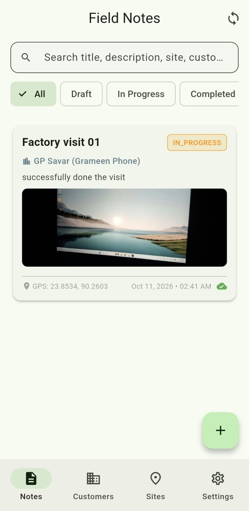
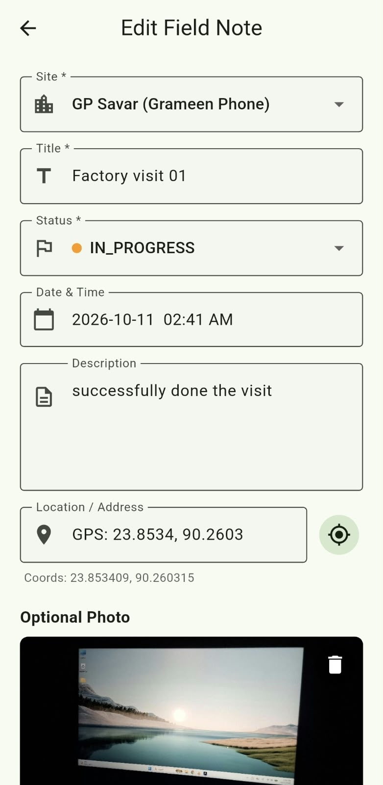
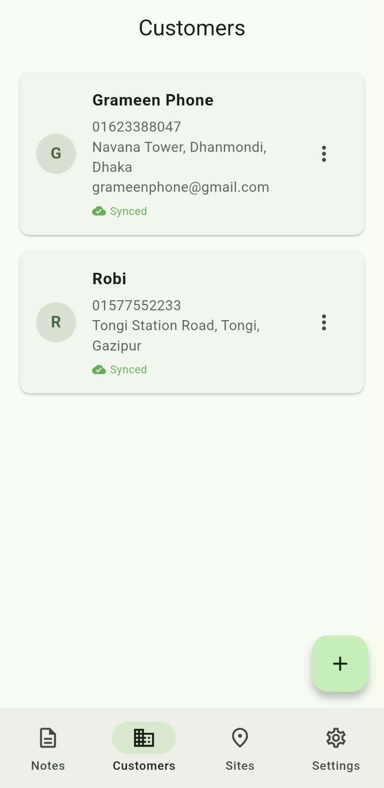
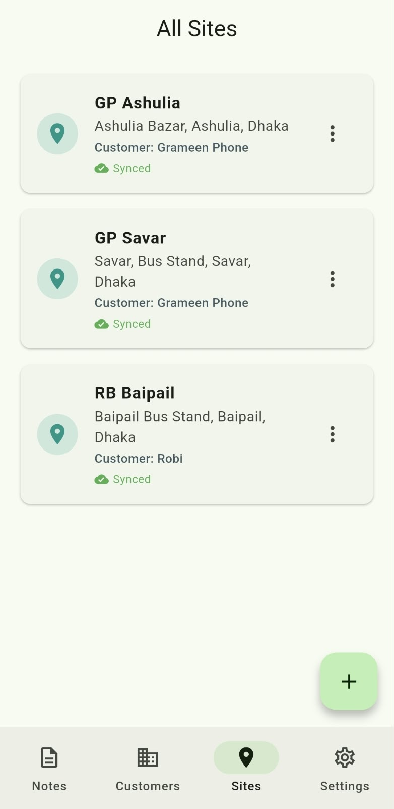
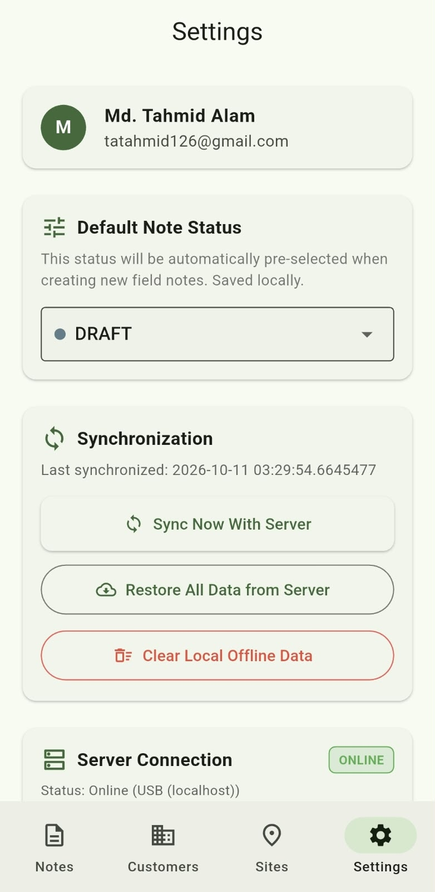
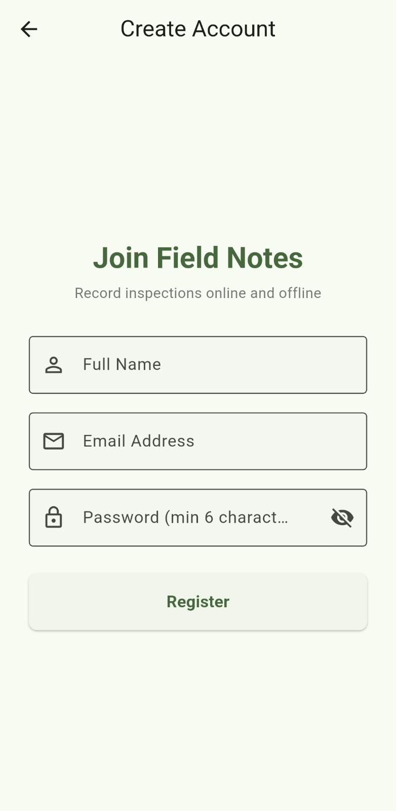

# Field Notes — Offline-First Field Service & Inspection Platform

[](https://flutter.dev)
[](https://dart.dev)
[](https://spring.io/projects/spring-boot)
[](https://www.oracle.com/java/)
[](https://bloclibrary.dev)
[](https://www.sqlite.org)
[](https://www.mysql.com)
[-brightgreen?logo=checkmarx)](https://github.com)

A production-grade, full-stack **Offline-First Field Service Management System** built for field technicians, inspectors, and site service engineers. Technicians can operate entirely offline in remote job sites without connectivity, capture inspection reports, attach real-time hardware camera photos and GPS coordinates, and seamlessly synchronize bi-directionally with an enterprise **Spring Boot 3 REST API** backend once connectivity is restored.

---

## 📱 Mobile Application Showcase

All screenshots captured live on a physical **Samsung Galaxy A55 5G** device:

| **01. Field Notes & Live Search** | **02. Note Form (GPS & Camera)** | **03. Customer Management** |
| :---: | :---: | :---: |
|  |  |  |
| *Debounced search, filter chips, status badges, GPS tag & green sync indicator* | *Site selector, high-precision GPS coordinate acquisition & captured photo preview* | *Enterprise customer accounts, direct contact details & sync state* |

| **04. Sites by Customer** | **05. Sync Engine & Settings** | **06. Secure Authentication** |
| :---: | :---: | :---: |
|  |  |  |
| *Site hierarchy, addresses, and customer-to-site relational bindings* | *Two-way delta sync, auto USB/Wi-Fi endpoint discovery & local cache purge* | *Stateless JWT authentication with strict client-side multi-user data isolation* |

---

## 🏗️ System Architecture & Data Flow

```
┌─────────────────────────────────────────────────────────────────────────────┐
│                            FLUTTER MOBILE CLIENT                            │
│                                                                             │
│   ┌────────────────────┐   Events    ┌──────────────────────────────────┐   │
│   │     UI Screens     │ ──────────> │          BLoC Layer              │   │
│   │  (Notes, Sites,    │ <────────── │  (Note, Customer, Site,          │   │
│   │   Customers, Sync) │   States    │   Sync, Auth BLoCs)              │   │
│   └────────────────────┘             └────────────────┬─────────────────┘   │
│                                                       │ Mutations / Queries │
│                                      ┌────────────────▼─────────────────┐   │
│                                      │    Local Database (SQLite)       │   │
│                                      │  (Embedded Offline Persistence)  │   │
│                                      └────────────────┬─────────────────┘   │
└───────────────────────────────────────────────────────┼─────────────────────┘
                                                        │
                      Background Two-Way Delta Sync     │ (JSON Over HTTPS/HTTP)
                      • Push: is_synced = 0 records     │
                      • Pull: modified >= lastSyncTime  │
                                                        ▼
┌─────────────────────────────────────────────────────────────────────────────┐
│                         SPRING BOOT 3 ENTERPRISE API                        │
│                                                                             │
│   ┌────────────────────────┐  JWT Auth  ┌───────────────────────────────┐   │
│   │ Security Filter Chain  │ ─────────> │     Controllers & Services    │   │
│   │ (Stateless Bearer JWT) │            │ (Sync, Note, Site, Customer)  │   │
│   └────────────────────────┘            └─────────────┬─────────────────┘   │
│                                                       │ JPA / Hibernate     │
│                                         ┌─────────────▼─────────────────┐   │
│                                         │      MySQL Server 8.x         │   │
│                                         │ (Multi-Tenant Persisted Data) │   │
│                                         └───────────────────────────────┘   │
└─────────────────────────────────────────────────────────────────────────────┘
```

### Relational Entity Hierarchy
The data model maintains strict relational integrity across both SQLite (mobile) and MySQL (server):

$$\text{User (Tenant)} \xrightarrow{1:N} \text{Customer} \xrightarrow{1:N} \text{Site} \xrightarrow{1:N} \text{Field Note}$$

- **User**: Authenticated account; owns all enterprise data.
- **Customer**: Client company (e.g., *Grameen Phone*, *Robi*).
- **Site**: Physical work location linked to a specific customer (e.g., *GP Savar*, *GP Ashulia*).
- **Field Note**: Detailed maintenance inspection log linked to a site, containing description, status (`DRAFT`, `IN_PROGRESS`, `COMPLETED`), timestamp, GPS latitude/longitude, and inspection photo URL.

---

## ⚡ Engineering Highlights & Interview Solutions

### 1. Robust Offline-First Engine & Conflict Resolution
- **Immediate Local Persistence**: When technicians create or modify notes, the app never blocks on network availability. Records are written immediately to SQLite with `is_synced = 0`.
- **Two-Way Delta Sync (`/api/sync`)**:
  - **Upstream Push**: Collects all local records where `is_synced = 0` and sends them in a single batch to the backend.
  - **Downstream Pull**: Sends the device's `lastSyncTimestamp`. The server returns only records modified after that timestamp.
  - **Atomic DB Batch Save**: Upon receiving server records, SQLite executes an atomic transaction with `ConflictAlgorithm.replace` and updates `is_synced = 1`.
- **Soft Deletion & Tombstones**: Records are marked `deleted = 1` rather than dropped from the DB, ensuring deletions reliably propagate across devices.

### 2. Multi-User Tenant Isolation on Mobile
- **The Problem**: In offline-first apps, logging out of User A and registering User B often leaks User A's local SQLite cache into User B's dashboard.
- **The Solution**: 
  - On `AuthLogoutRequested` or new registration, `DatabaseService.instance.clearAll()` wipes SQLite clean and purges `lastSyncKey`.
  - In `main.dart`, the home widget is keyed dynamically by user ID: `HomeScreen(key: ValueKey(state.user.id))`, guaranteeing Flutter builds an isolated, fresh widget tree for each account.

### 3. Smart Network Auto-Discovery (USB & Wi-Fi LAN Fallback)
- **Zero-Config Developer & Demo Experience**:
  - Probes **USB Port Forwarding (`localhost:8080` via `adb reverse`)** with a 400ms probe.
  - If USB is unplugged or fails, automatically switches to the PC's **Wi-Fi LAN IP (`192.168.10.99:8080`)** within 700ms.
  - If completely disconnected, smoothly enters **Offline Mode** with an amber `cloud_off` indicator—never throwing raw `SocketException` or `Connection refused (errno = 111)` crashes into the UI.

### 4. Hardware Integrations (Camera & GPS)
- **Geolocation**: One-tap GPS acquisition via `geolocator` capturing real-time device Latitude & Longitude with visual coordinates displayed on the card.
- **Camera & Photos**: Native camera launch via `image_picker`, local file caching, and background multipart file upload (`/api/upload`) returning static hosted URLs (`/uploads/...`).

### 5. Debounced High-Performance Search & Filtering
- Search bar queries across **Title**, **Description**, **Location**, **Site Name**, and **Customer Name**.
- Debounced by **250ms** via Dart `Timer` to prevent unnecessary SQLite queries during fast typing.
- Interactive status filter chips (`ALL`, `DRAFT`, `IN_PROGRESS`, `COMPLETED`).

---

## 🛠️ Technology Stack

| Layer | Component | Description |
| :--- | :--- | :--- |
| **Mobile Frontend** | **Flutter 3.x / Dart 3.x** | Cross-platform high-performance mobile UI |
| **State Management**| **flutter_bloc 9.x** | Predictable, testable BLoC pattern with unidirectional data flow |
| **Local Storage**   | **sqflite 2.x** | High-performance embedded SQLite on mobile |
| **Hardware APIs**   | **geolocator / image_picker** | Native Android/iOS GPS and Camera access |
| **Backend API**     | **Spring Boot 3.x / Java 17** | Enterprise RESTful web services |
| **Security**        | **Spring Security 6 + JJWT** | Stateless Bearer token auth, BCrypt password hashing |
| **ORM / Data**      | **Spring Data JPA / Hibernate** | Object-Relational Mapping with MySQL 8.x |
| **Server Database** | **MySQL 8.x** | Multi-tenant transactional database |
| **Testing**         | **JUnit 5, Mockito, Flutter Test** | Comprehensive backend and frontend test suites |

---

## 🧪 Comprehensive Automated Test Suites

The project includes **48 automated unit and widget tests** passing with a 100% success rate:

```bash
# Mobile Test Suite (38 Tests Passed)
00:06 +38: All tests passed!

# Backend Test Suite (10 Tests Passed)
[INFO] Tests run: 10, Failures: 0, Errors: 0, Skipped: 0
[INFO] BUILD SUCCESS
```

### Mobile Test Coverage (`fieldnotes_app/test/`):
- `models_test.dart`: Serialization/deserialization for User, Customer, Site, and FieldNote models.
- `database_service_test.dart`: SQLite CRUD, multi-table joins, soft-delete filtering, and batch sync transactions.
- `blocs_test.dart`: BLoC state streams for CustomerBloc, SiteBloc, and NoteBloc.
- `form_validation_test.dart`: Form validation edge cases, required fields, and input sanitization.
- `notes_screen_search_widget_test.dart`: Full widget test simulating user typing, 250ms debounce verification, and live filtering.

### Backend Test Coverage (`fieldnotes-backend/src/test/`):
- `CustomerServiceTest.java`: Multi-tenant customer CRUD, soft-deleting, and duplicate prevention.
- `FieldNoteServiceTest.java`: Status validation, site binding, timestamp assignment, and search queries.

---

## 📡 REST API Reference

### 🔐 Authentication (`/api/auth`)
| Method | Endpoint | Description | Auth Required |
| :--- | :--- | :--- | :---: |
| `POST` | `/api/auth/register` | Register new user account | ❌ No |
| `POST` | `/api/auth/login` | Authenticate and obtain JWT Bearer token | ❌ No |
| `GET` | `/api/auth/me` | Fetch currently logged-in user profile | ✅ Yes |
| `GET` | `/api/auth/ping` | Healthcheck probe for auto-discovery | ❌ No |

### 🏢 Customers (`/api/customers`)
| Method | Endpoint | Description | Auth Required |
| :--- | :--- | :--- | :---: |
| `GET` | `/api/customers` | Fetch all active customers for authenticated user | ✅ Yes |
| `POST` | `/api/customers` | Create a new customer | ✅ Yes |
| `PUT` | `/api/customers/{id}` | Update customer details | ✅ Yes |
| `DELETE` | `/api/customers/{id}` | Soft delete customer | ✅ Yes |

### 📍 Sites (`/api/sites`)
| Method | Endpoint | Description | Auth Required |
| :--- | :--- | :--- | :---: |
| `GET` | `/api/sites` | List sites (supports filter `?customerId={id}`) | ✅ Yes |
| `POST` | `/api/sites` | Create a new site linked to a customer | ✅ Yes |
| `PUT` | `/api/sites/{id}` | Update site information | ✅ Yes |
| `DELETE` | `/api/sites/{id}` | Soft delete site | ✅ Yes |

### 📝 Field Notes (`/api/notes`)
| Method | Endpoint | Description | Auth Required |
| :--- | :--- | :--- | :---: |
| `GET` | `/api/notes` | List notes (supports `?status=...&siteId=...&search=...`) | ✅ Yes |
| `POST` | `/api/notes` | Create a new inspection note | ✅ Yes |
| `PUT` | `/api/notes/{id}` | Update note details or status | ✅ Yes |
| `DELETE` | `/api/notes/{id}` | Soft delete note | ✅ Yes |

### 🔄 Two-Way Synchronization Engine (`/api/sync`)
| Method | Endpoint | Description | Auth Required |
| :--- | :--- | :--- | :---: |
| `POST` | `/api/sync` | Bi-directional batch sync (push local deltas, pull server deltas) | ✅ Yes |
| `GET` | `/api/sync/restore` | Full database restore on new device login | ✅ Yes |
| `POST` | `/api/upload` | Multipart photo upload for inspection evidence | ✅ Yes |

---

## 🚀 Setup & Execution Guide

### Prerequisites
- **Java 17+** & **Maven**
- **MySQL Server 8.x** running locally on port 3306 with database `fieldnotes_db`
- **Flutter SDK 3.x+**
- Physical Android device or Emulator

### 1. Configure & Start the Backend
Ensure MySQL is running with database `fieldnotes_db`, then:
```bash
cd fieldnotes-backend
./mvnw spring-boot:run
```
The server will start at `http://localhost:8080`.

### 2. Connect Mobile Device via USB
When running on a physical Android phone via USB cable:
```bash
adb reverse tcp:8080 tcp:8080
```
*(This maps the phone's `localhost:8080` directly to the PC's Spring Boot backend).*

### 3. Run the Flutter Mobile Application
```bash
cd fieldnotes_app
flutter pub get
flutter run
```

---

## 👨‍💻 Developer & Interviewer Quick Notes

- **How does Offline Mode work?** Turn on Airplane mode or unplug the USB cable. Create a note, take a photo, and add a site. The app saves everything locally with `is_synced = 0`. Reconnect to Wi-Fi or plug in USB, and tap **Sync** — the green cloud icon confirms the note has safely synced to MySQL!
- **How is data isolated between users?** Log out and register a new user. The local SQLite database is automatically wiped clean, preventing data bleeding. Log in with the previous user, and their notes restore seamlessly from the backend.

---
*Developed as an enterprise-grade Offline-First Mobile & Backend Engineering Showcase.*
